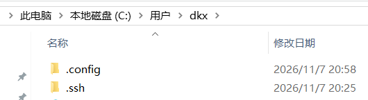

准备工作：

执行命令mkdir -p ~/.ssh，将.ssh.zip放到.ssh目录中解压



设置git账户，如果没有设置的话：

```tex
git config --global user.name "你的用户名"
git config --global user.email "你的邮箱@example.com"
```

校验.ssh是否可成功连接

```tex
ssh -i ~/.ssh/id_ut9******* -T git@github.com
```

输出如下说明成功

```tex
Hi username! You've successfully authenticated, but GitHub does not provide shell access.
```

git push -u origin main报错解决

直接执行：

```tex
git pull origin main --allow-unrelated-histories
```

如果执行后没有冲突，并且成功合并，再执行：
```tex
git push -u origin main
```

注意：不要使用git push --force来强制合并

1.将node_modes.zip解压到博客目录中

2.执行命令Set-ExecutionPolicy -Scope CurrentUser RemoteSigned按Y

3.执行命令npm install --force

- --force绕过

4.执行命令npm install -g hexo@4.2.1

- 如果提示需要下载npm install hexo --save那么就执行npm install hexo@4.2.1 --save
- 如果hexo还是提示npm install hexo --save那么就在最后加上 --force也可能是网络问题多试几次

windows下使用powershell控制博客网站，使用git上传源博客